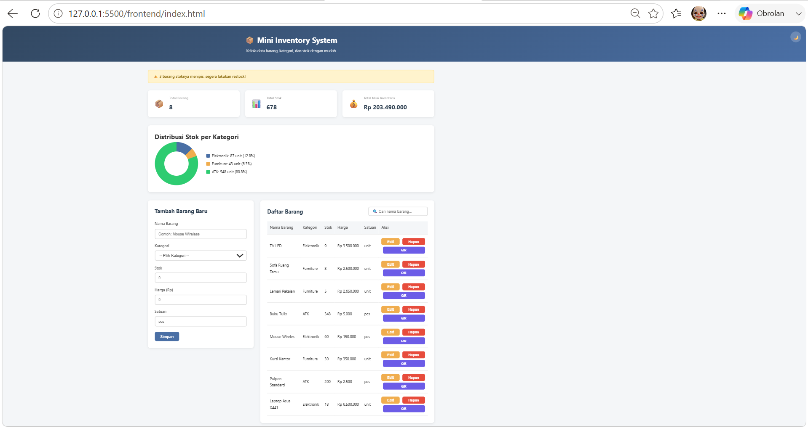
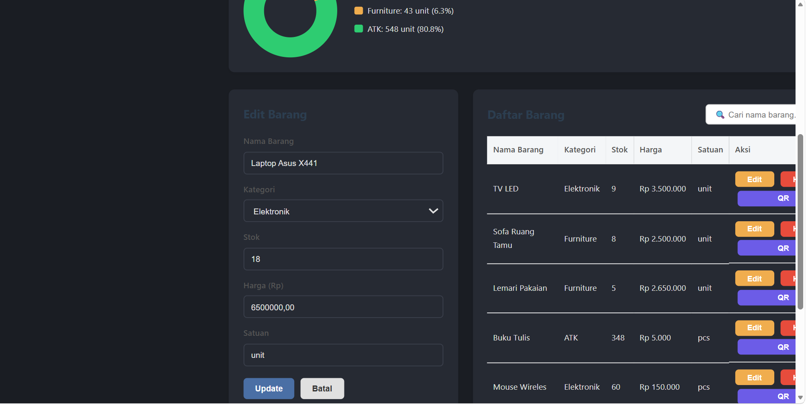
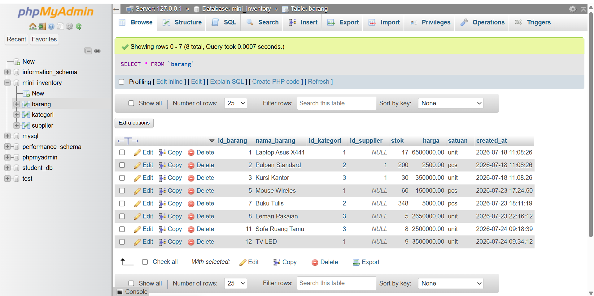

# 📦 Mini Inventory System

Aplikasi manajemen inventaris sederhana berbasis web untuk mengelola data barang, kategori, dan supplier.

## 👤 Identitas

- **Nama**: [Geta Martia Lisa]
- **NIM**: 2025806068
- **Kelas**: Teknologi Informasi / 2 Pagi
- **Mata Kuliah**: Pemrograman Dasar
- **Dosen**: Rintis Mardika Sunarto

## 📋 Tema Proyek

**Mini Inventory System** — aplikasi untuk mengelola data barang beserta kategori dan supplier-nya, lengkap dengan fitur pencatatan stok, harga, dan visualisasi data.

## 📝 Deskripsi Aplikasi

Aplikasi ini memungkinkan pengguna untuk melakukan pencatatan barang inventaris secara digital, meliputi penambahan, pengeditan, penghapusan, dan penampilan data barang yang terhubung dengan kategori melalui relasi database. Data tersimpan secara real-time menggunakan REST API dan database MySQL, dilengkapi visualisasi grafik dan sistem QR code untuk labeling barang.

## 🛠️ Teknologi yang Digunakan

- **Frontend**: HTML5, CSS3, JavaScript (Fetch API, Async/Await, DOM Manipulation)
- **Backend**: Node.js, Express.js
- **Database**: MySQL
- **Library**: QRCode.js (CDN)
- **Tools**: XAMPP, phpMyAdmin, VS Code, Thunder Client

## ✨ Fitur Utama

- CRUD lengkap untuk Barang dan Kategori (Create, Read, Update, Delete)
- Validasi input (field wajib diisi)
- Tampilan responsive (desktop & mobile)

## 🎁 Fitur Tambahan (Bonus)

- 📊 Dashboard statistik dengan animasi counter (total barang, total stok, total nilai inventaris)
- 🍩 Donut chart distribusi stok per kategori (dibuat murni CSS, tanpa library eksternal)
- 📱 QR Code generator untuk setiap barang (simulasi sistem labeling gudang)
- ⚠️ Banner peringatan otomatis untuk barang dengan stok menipis (< 10)
- 🔍 Search/filter barang secara real-time
- 🌙 Dark mode
- 🔔 Toast notification (pengganti alert bawaan browser)
- 🏷️ Badge status stok (Menipis / Aman)
- 🪟 Modal konfirmasi custom untuk aksi hapus

## 📁 Struktur Project
UAS-PemrogramanDasar-2025806068-GetaMartiaLisa/
│
├── backend/
│ ├── app.js
│ ├── package.json
│ ├── .env.example
│ ├── config/
│ │ └── db.js
│ ├── controllers/
│ │ ├── barangController.js
│ │ └── kategoriController.js
│ ├── models/
│ │ ├── barangModel.js
│ │ └── kategoriModel.js
│ └── routes/
│ ├── barangRoutes.js
│ └── kategoriRoutes.js
│
├── frontend/
│ ├── index.html
│ ├── css/
│ │ └── style.css
│ └── js/
│ └── barang.js
│
├── database/
│ └── database.sql
│
├── screenshots/
│ ├── dashboard.png
│ ├── form.png
│ └── database.png
│
├── README.md
├── .gitignore
└── LICENSE

## 🚀 Cara Menjalankan Aplikasi

### 1. Clone Repository
```bash
git clone https://github.com/username/UAS-PemrogramanDasar-2025806068-GetaMartiaLisa.git
cd UAS-PemrogramanDasar-2025806068-GetaMartiaLisa
```

### 2. Setup Database
- Buka XAMPP, jalankan **Apache** dan **MySQL**
- Buka `http://localhost/phpmyadmin`
- Import file `database/database.sql`

### 3. Setup Backend
```bash
cd backend
npm install
```
- Copy file `.env.example` menjadi `.env`
- Sesuaikan isi `.env` dengan konfigurasi database lokal Anda
```bash
npx nodemon app.js
```
- Server akan berjalan di `http://localhost:5000`

### 4. Jalankan Frontend
- Buka file `frontend/index.html` langsung di browser, atau
- Gunakan ekstensi **Live Server** di VS Code untuk hasil terbaik

## 🔌 Daftar Endpoint REST API

### Barang (`/api/barang`)
| Method | Endpoint | Deskripsi |
|--------|----------|-----------|
| GET | `/api/barang` | Ambil semua data barang |
| GET | `/api/barang/:id` | Ambil satu barang berdasarkan ID |
| POST | `/api/barang` | Tambah barang baru |
| PUT | `/api/barang/:id` | Update data barang |
| DELETE | `/api/barang/:id` | Hapus barang |

### Kategori (`/api/kategori`)
| Method | Endpoint | Deskripsi |
|--------|----------|-----------|
| GET | `/api/kategori` | Ambil semua data kategori |
| GET | `/api/kategori/:id` | Ambil satu kategori berdasarkan ID |
| POST | `/api/kategori` | Tambah kategori baru |
| PUT | `/api/kategori/:id` | Update data kategori |
| DELETE | `/api/kategori/:id` | Hapus kategori |

## 📸 Screenshot Aplikasi





## 🔗 Link Repository

[https://github.com/username/UAS-PemrogramanDasar-2025806068-GetaMartiaLisa]